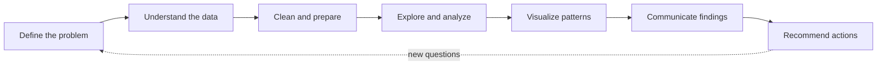

<!--
  ============================================================
  Search for "YOUR_" to find every placeholder.
  Optional widgets (stats, snake) depend on third-party services.
  If an image breaks, delete its line. The page works without them.
  ============================================================
-->

<div align="center">


<a href="https://github.com/YOUR_GITHUB_USERNAME">
  
</a>

<br><br>

[](https://www.linkedin.com/in/YOUR_LINKEDIN_USERNAME)
[](mailto:YOUR_EMAIL@example.com)
[](YOUR_PORTFOLIO_URL)
[](https://github.com/YOUR_GITHUB_USERNAME)

**[About](#-about-me) · [Focus](#-what-i-do) · [Skills](#-toolkit) · [Projects](#-featured-projects) · [Workflow](#-how-i-work) · [Learning](#-currently-developing) · [Contact](#-contact)**

</div>

---

## 👤 About Me

I'm a **Business Information Systems** student building my path as a data analyst. My BIS background helps me see data the way a business does: how processes create it, how databases organize it, and how it should support decisions.

My approach is practical. I start with the business question, check and clean the data, explore it with **SQL** and **Python**, visualize what matters, and explain what the results mean.

> 🎯 **Looking for:** Data Analyst internships, junior opportunities, and real projects where data helps people decide better.

---

## 🔍 What I Do

<table>
  <tr>
    <td width="50%" valign="top">
      <h4>🧹 Data Cleaning & Preparation</h4>
      Handling missing values, duplicates, and inconsistent formats so the analysis can be trusted.
    </td>
    <td width="50%" valign="top">
      <h4>🔎 Exploratory Data Analysis</h4>
      Finding patterns, outliers, and relationships before drawing any conclusions.
    </td>
  </tr>
  <tr>
    <td valign="top">
      <h4>🗃️ SQL Analysis</h4>
      Querying and aggregating relational data to answer specific business questions.
    </td>
    <td valign="top">
      <h4>📊 BI & Dashboards</h4>
      Building clear Power BI views of key metrics for non-technical audiences.
    </td>
  </tr>
  <tr>
    <td valign="top">
      <h4>🗣️ Reporting & Storytelling</h4>
      Turning results into plain-language insights and evidence-based recommendations.
    </td>
    <td valign="top">
      <h4>🏢 Business Systems Thinking</h4>
      Using ERDs, UML, and process analysis to understand where data comes from.
    </td>
  </tr>
</table>

---

## 🧰 Toolkit

<sub>Tools I work with at an intermediate, developing level. No fake percentages.</sub>

<div align="center">


</div>

<details>
<summary><b>📂 Skills by category (click to expand)</b></summary>

<br>

| Category | Tools & Knowledge |
|---|---|
| **Programming & Analysis** | Python, Pandas, NumPy, Matplotlib, Seaborn, Jupyter Notebook |
| **Databases & Querying** | SQL, database design |
| **BI & Visualization** | Power BI, Excel |
| **Productivity & Reporting** | Git, GitHub, notebook-based reporting |
| **Business Systems & Modeling** | ERD, UML, business process analysis |

</details>

---

## 🚀 Featured Projects

Each project follows the same path: **Question → Data Prep → Analysis → Visualization → Insights → Recommendations.**

> ⚠️ The cards below are **placeholders**. Replace them with real projects and only state findings you have verified.

<table>
  <tr>
    <td width="33%" valign="top">
      <h4>📌 YOUR_PROJECT_1</h4>
      <b>Question:</b> YOUR_BUSINESS_QUESTION<br>
      <b>Data:</b> YOUR_DATASET<br>
      <b>Tools:</b> Python · Pandas · Seaborn<br>
      <b>Insight:</b> <i>add after verifying</i><br><br>
      <a href="YOUR_REPO_URL">Repository</a> · <a href="YOUR_NOTEBOOK_URL">Notebook</a>
    </td>
    <td width="33%" valign="top">
      <h4>📌 YOUR_PROJECT_2</h4>
      <b>Question:</b> YOUR_BUSINESS_QUESTION<br>
      <b>Data:</b> YOUR_DATASET<br>
      <b>Tools:</b> SQL · Excel<br>
      <b>Insight:</b> <i>add after verifying</i><br><br>
      <a href="YOUR_REPO_URL">Repository</a> · <a href="YOUR_REPORT_URL">Report</a>
    </td>
    <td width="33%" valign="top">
      <h4>📌 YOUR_PROJECT_3</h4>
      <b>Question:</b> YOUR_BUSINESS_QUESTION<br>
      <b>Data:</b> YOUR_DATASET<br>
      <b>Tools:</b> Power BI<br>
      <b>Insight:</b> <i>add after verifying</i><br><br>
      <a href="YOUR_REPO_URL">Repository</a> · <a href="YOUR_DASHBOARD_URL">Dashboard</a>
    </td>
  </tr>
</table>

<details>
<summary><b>🧩 Reusable project card template</b></summary>

<br>

```markdown
### Project Title
- **Business question:** what decision does this support?
- **Data source:** dataset name, size, origin
- **Tools:** Python, SQL, Power BI ...
- **Methods:** cleaning steps, EDA, KPIs, segmentation ...
- **Key findings:** only verified results
- **Recommendation:** what the business should do next
- **Links:** repository · notebook · dashboard
```

</details>

---

## 🧭 How I Work



| Step | Focus |
|:---:|---|
| 1 | Clarify the business question and what a useful answer looks like |
| 2 | Review data structure, definitions, and quality |
| 3 | Fix missing values, duplicates, types, and inconsistencies |
| 4 | Use SQL and Python to examine trends and relationships |
| 5 | Choose charts that make the important patterns obvious |
| 6 | Explain results in plain language for the audience |
| 7 | Offer evidence-based next steps and note limitations |

---

## 🌱 Currently Developing

These are learning goals, not claims of proficiency.

- [ ] Advanced SQL: window functions, CTEs, query optimization
- [ ] Statistical reasoning and correct interpretation of results
- [ ] Power BI data modeling and DAX fundamentals
- [ ] Data storytelling for decision-makers
- [ ] Completing end-to-end portfolio projects

---

## 📈 GitHub Activity

<details>
<summary><b>Show optional statistics</b></summary>

<br>

<div align="center">


</div>

<sub>Live data from my public activity. It will be sparse until I publish more repositories.</sub>

</details>

---

## 🤝 Contact

I'm open to internships, junior roles, feedback, and conversations about data.

| | |
|---|---|
| 💼 **LinkedIn** | [linkedin.com/in/YOUR_LINKEDIN_USERNAME](https://www.linkedin.com/in/YOUR_LINKEDIN_USERNAME) |
| ✉️ **Email** | [YOUR_EMAIL@example.com](mailto:YOUR_EMAIL@example.com) |
| 🌐 **Portfolio** | [YOUR_PORTFOLIO_URL](YOUR_PORTFOLIO_URL) |
| 🐙 **GitHub** | [@YOUR_GITHUB_USERNAME](https://github.com/YOUR_GITHUB_USERNAME) |

<div align="center">

<br>

<sub><em>Data doesn't answer questions on its own. Good analysis does.</em></sub>


</div>
